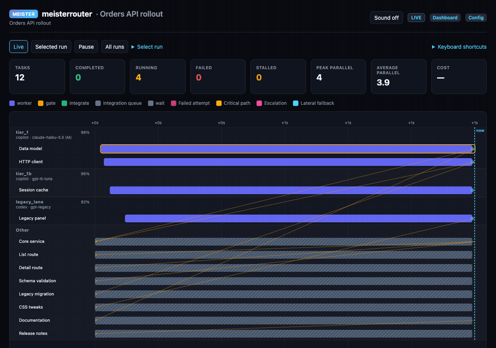
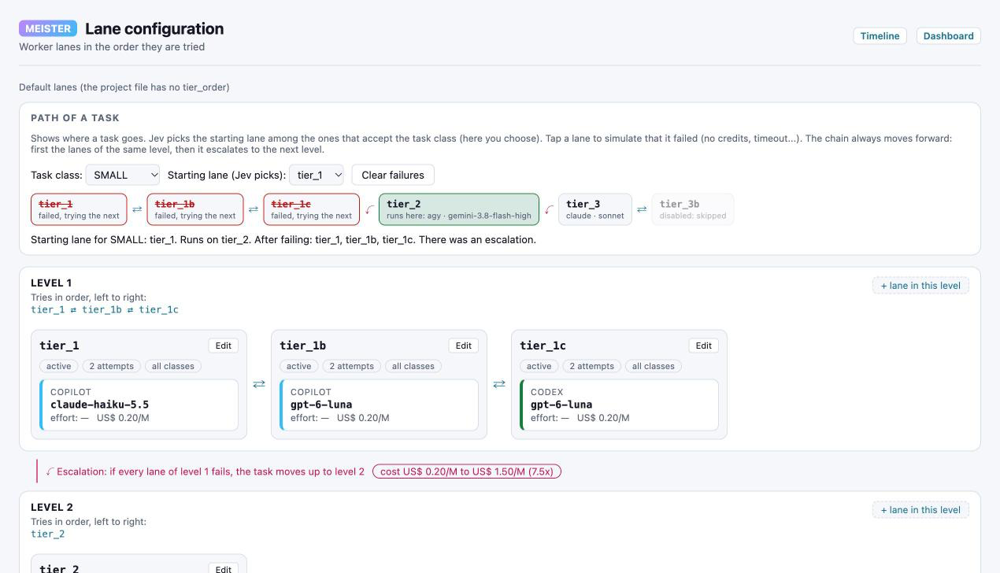
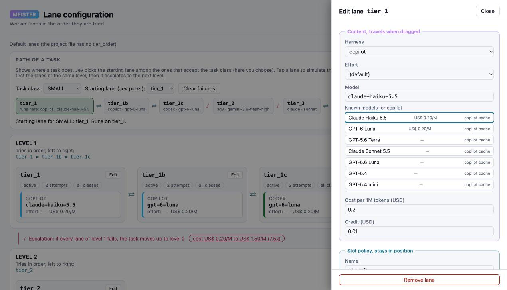

# 🔮 MeisterRouter

🌐 **English** · [Português (Brasil)](README.pt-BR.md)

### Hand your AI coding agents a plan. Come back to code that is already tested and merged.

**MeisterRouter** (`meister`) splits a plan into tasks and runs them **in parallel** on the AI CLIs you already pay for: **GitHub Copilot, Claude, Codex, Gemini and Kiro**. Each task works in its own git worktree, and nothing reaches `main` until a **deterministic gate** (your tests and linters, not the agent's opinion) says it passes. A rejected task is repaired automatically. When one subscription runs out of quota, the next one takes over.

You keep your premium model for what it is good at: thinking. The cheaper lanes do the typing, and a gate you control decides what gets in.



<sub>This is the live timeline, which opens in your browser when a run starts (`/timeline`). It plays a **demo run** (synthetic data) generated by MeisterRouter itself; no real project appears in it.</sub>

## 🧨 What you stop doing

| Before | With MeisterRouter |
|---|---|
| Burning your best model's quota on typing | The orchestrator only plans and verifies. Tasks run on the cheapest lane that fits (list prices span US$ 0.20 to US$ 8.00 per 1M tokens), and the expensive lanes only enter on escalation. |
| Reading every diff because "done" means "the agent says so" | A task is done when `pytest`, `mvn test`, `npm test`, `cargo test` or whatever you configured passes, in an isolated worktree, before integration. |
| Watching agents overwrite each other | Tasks declare the files they may touch. Tasks that share none run in parallel; a change outside the declared scope is blocked. |
| Restarting from zero when task 7 fails | Runs resume per task: finished work is reused, even after you edit the plan. |
| Waiting for the quota to come back | A fallback chain moves the task to the next lane, with rate-limit and circuit-breaker handling. |
| Wondering where the time and money went | A live timeline and dashboard with per-task cost, phases and escalations. |

## 🚀 Get started

Two commands, then just talk.

```bash
# 1. Install (macOS or Linux; Windows: see the guide)
curl -fsSL https://raw.githubusercontent.com/CristianonCarvalho/meisterrouter/main/bin/install.sh | bash

# 2. In your project, once
meister setup --project
```

**3. Open your orchestrator LLM** (for example Claude Code) and say what you want:

> *"I want a date filter on the orders screen"*

**That sentence is the whole interface.** Your LLM talks to you, writes the plan and runs it with Meister: you do not type `meister plan` or `meister orchestrate`. When the run starts, **the live timeline opens in your browser by itself**: you follow every task in real time, with the harness and model running it, its phases and its cost (in the terminal: `meister timeline`). Commit, push and merge still wait for your OK.

You need git and at least one AI CLI you already pay for (see [Prerequisites](#-prerequisites)). Installer options, updating, the Jev key, running the commands by hand and recovering from failures are in the [Getting started guide](docs/getting-started.md).

## 🧭 How it works

1. **You (or your orchestrator LLM) write a plan**: small tasks, each one with the files it may change and the tasks it depends on ([plan format](docs/plan-format.md)).
2. **Meister routes each task** to a lane (a subscription CLI with a model), in parallel wherever the files do not overlap.
3. **Every task runs in its own git worktree.** The worker edits there, never in your checkout.
4. **The deterministic gate runs** (tests, lint, types). Rejected? One automatic repair attempt. Out of quota? Next lane.
5. **Approved work is integrated**, and `main` moves, by fast-forward, only at the end.

The only non-deterministic piece is **Jev** (through OpenRouter), an optional router that picks the starting lane and judges the outcome. Without it, set `router: {mode: first}` and routing is fully deterministic, with no network.

📐 More in the [diagrams](docs/diagrams.md): components, sequence, routing, failures, gates and states.

## 🧪 Proof, not promises

- **It is developed with itself.** Changes to this repository run through `meister orchestrate` and the same gate (2,300+ tests, ruff and mypy on Linux and Windows in CI).
- **Real stacks, real gates.** The gate detects `pytest`, `vitest`, `npm test`, `cargo test` and **Maven** (`pom.xml`, Java 8 included), and you can set your own commands. See [Java 8, Maven and GitLab](docs/java-maven.md).
- **Works with a single subscription.** You do not need all five CLIs; for example, [Kiro alone](docs/kiro.md) is one command: `meister config init --kiro`.
- **Honest limits.** Windows is native but still under validation, Kiro is not verified on Windows, and a subagent is the better tool for a one-line change (see below).

**When a subagent is the better tool:** a small edit, an exploration, or an interactive debugging session. MeisterRouter adds process (a plan, scoped tasks, a full gate on each one), so it pays off on multi-task plans, not on one-off changes.

## ✅ Prerequisites

| | What | What for |
|---|---|---|
| **Required** | macOS, Linux, or Windows 10/11 (native, **under validation**; requires [Git for Windows](https://git-scm.com/download/win)) | Where MeisterRouter runs. See [Windows](docs/advanced.md#windows). |
| **Required** | At least one subscription-backed AI CLI: `copilot`, `claude`, `codex`, `agy` (Antigravity/Gemini) or `kiro-cli` | These are the workers. `meister setup` shows which ones it found. |
| **Recommended** | An orchestrator LLM with planning, for example **Claude Code** | It talks to you, writes the plan in the [plan format](docs/plan-format.md) (`meister plan guide` and `meister plan new` give it the rules and a skeleton) and triggers Meister. If you use the [Superpowers](https://github.com/obra/superpowers) skill, its plans already follow that format. |
| **Optional** | An OpenRouter API key | Only **Jev** uses it (picks the lane for each task). Without it, set `router: {mode: first}`. |
| **Optional** | [Herdr](#-herdr-optional-watch-the-workers-live) or tmux | To watch each worker live, in its own tab. |

## 🎯 Choose the models and their order

Each **lane** is one subscription (a harness such as Copilot, Codex, Claude or Gemini) running one model. The **order** of the lanes is the fallback chain, always moving forward: if a lane fails or runs out of credit, Meister moves on to the next. You set all of it on a web page, with no file to edit:

```bash
meister config web       # opens the configuration page of the current project
```

(`--no-open` only prints the address, for a machine without a screen. `meister models` lists the active lanes in the terminal.)



### Levels, lanes and escalation

- Lanes are grouped in **levels** (the number at the end of the name: `tier_1`, `tier_1b` and `tier_1c` are level 1). Lanes of the same level are alternatives: Meister tries them from left to right (⇄ lateral fallback).
- When **every lane of a level fails**, the task **escalates** to the next level (⤹). The band between levels shows how much the price per million tokens goes up, so you see what an escalation costs (for example, from US$ 0.20 to US$ 1.50).
- Each box is a **slot**: its name, whether it is active, how many attempts it gets and which task classes it accepts, with the lane's content inside (harness, model, effort and cost).
- **Path of a task**, at the top, answers "where would my task run?". Pick the task class and the starting lane, then click a lane to pretend it failed (no credit, timeout...). A sentence tells where the task ends up running and whether it escalated. Nothing is executed; the picture above shows Copilot and Codex failing and the task landing on Gemini.



### Editing a lane

Click **Edit** on a slot. The drawer has two groups:

- **Content** (it travels when you drag the card): harness, effort (the list follows the harness), model, cost per million tokens and credit.
- **Slot policy** (it stays in place): name, on or off, attempts, parallel limit, idle and maximum time, the task classes Jev may send to the lane, and what it is best for.

The **model** is picked from the known models of the lane's harness, each with the exact name that harness expects (they spell the same model differently: `claude-haiku-5.5` on Copilot, `haiku` on Claude) and its cost when known. You can also type any name; if it is not on the list, the page warns you without blocking you. Where the lists come from:

| Harness | List of models |
|---|---|
| Gemini (`agy`) | read live from the tool itself |
| Codex | the list Codex keeps for itself |
| Claude | its aliases (`haiku`, `sonnet`, `opus`) and full names |
| Copilot | read once from its `/model` picker with `meister config refresh-models copilot` (Copilot has no list command; the picker is opened in a simulated terminal and **no prompt is sent**, so it spends no credit) |

### Reorder, create and remove

- **Swap content between slots:** drag a card onto another slot (on a phone, tap one card and then the other). The names and policies stay where they are, so the fallback structure is kept while you change who runs where.
- **+ lane in this level** adds an alternative; **+ new level** adds an escalation step at the end of the chain; **Remove lane** deletes one (confirm with a second tap).
- The **Changes to save** panel lists exactly what will be written. **Save** applies it, **Revert** drops it and **Restore default** goes back to the packaged lanes.

### Which project am I configuring?

Configuration stays **per project**, and the page always says which one it is editing: the **Project** bar at the top shows a select box and the full path of the project (and the source file below it). Pick another project in the select box and the page loads that project's lanes; nothing is written in the project you left.

- **Automatic list:** a project joins the list when you run `meister config web`, start a dashboard or run `meister orchestrate` inside it. The list is kept in `~/.meister/projects.json`.
- **Discover projects:** type a folder (for example the one that holds all your repositories) and Meister scans it, up to 3 levels deep, for folders with `.meister/` or `meister.config.yaml`. You tick the ones you want and register them.
- **Add project:** registers one folder by its absolute path. It must have `.meister/`, `meister.config.yaml` or `.git`; your personal folder and the filesystem root are refused.
- Each project is checked on its own: a run active in one project blocks only that project, and a project with a run shows it in the select box.

### Good to know

- Saving is blocked while a run is active (the run already loaded its lanes), and the page is read-only when opened remotely, for example over Tailscale: editing is local only.
- Saving keeps a backup of the previous configuration and never leaves a half-written file. Names are checked before saving (unique, ending in the level number) and at least one lane must stay on.
- A saved list belongs to the project and replaces the default one, so it no longer follows future changes to the packaged lanes; **Restore default** undoes that.

Reasoning effort, in the **Effort** list of the drawer, depends on the harness:

| Harness | Effort values (optional; leave it on "default" to keep the harness setting) |
|---|---|
| `copilot` | none, minimal, low, medium, high, xhigh, max |
| `claude`, `agy` | low, medium, high, xhigh, max |
| `codex` | minimal, low, medium, high, xhigh |
| `kiro-cli` | low, medium, high, xhigh, max (the model must support it) |

More on this page and the other settings: [the /config screen](docs/advanced.md#the-config-screen-lanes) and [advanced configuration](docs/advanced.md#advanced-configuration).

## 🔍 Under the hood

These recordings show what your orchestrator LLM runs for you. **You do not type any of it.** The workers are simulated, so the demos are fast and spend no quota; the orchestration, worktrees, gate, fallback and merge are the real thing.

### Parallel by default, merged only at the end

Tasks 1 and 2 share no files, so they run together. Task 3 depends on both and waits. `main` moves only after everything passed.


### The gate decides, not the agent

The worker's first attempt has a bug. The gate catches it before anything is integrated, the task is repaired automatically, and only the passing version reaches `main`.


### Quota ran out? The next lane takes over


### The dashboard

`meister dashboard` (at `http://localhost:5050`) adds per-run metrics, cost, overhead and the task table:


<sub>The dashboard image also uses a demo run (synthetic data).</sub>

## 💻 Herdr (optional): watch the workers live

[Herdr](https://herdr.dev) is a terminal workspace manager. MeisterRouter does not need it, but it can run as a Herdr plugin: each worker then opens in a **visible tab**, and shortcuts open the dashboard and the timeline as popups.

| Shortcut | Opens |
|---|---|
| `prefix+m` | Starts the orchestration in the workspace |
| `prefix+shift+m` | Dashboard popup |
| `prefix+t` | Timeline (Gantt) popup |

To use it, install Herdr (`curl -fsSL https://herdr.dev/install.sh | sh`) and run `meister setup`: it links the plugin and registers the shortcuts in a managed block of Herdr's `config.toml`, with a backup. Without Herdr, `meister setup` warns and carries on.

`runtime.host` in `meister.config.yaml` chooses where each worker runs:

| Value | Where the worker runs |
|---|---|
| `auto` (default) | Herdr when it is reachable, otherwise a background process (`auto` never picks tmux) |
| `process` | A plain background process (no tabs, popups or shortcuts). This is the only host on Windows. |
| `herdr` | A visible Herdr tab (requires Herdr) |
| `tmux` | A tmux window (requires tmux 3.0 or newer) |

## 📚 More documentation

- [Getting started](docs/getting-started.md): install options, the Jev key, how a session goes step by step, and running the commands by hand.
- [Plan format](docs/plan-format.md): how to write or review a plan (`plan guide`, `plan new`; Superpowers is optional), dependencies and parallelism.
- [Alternative install and advanced commands](docs/advanced.md): other ways to install, shortcuts by hand, `plan`/`orchestrate` by hand, `init`/guard, `classify`, `control`, `worker`, `clean`, `--resume`, dashboard and timeline options, advanced configuration, tests and project layout.
- [Diagrams](docs/diagrams.md): components, sequence and flows.
- [Execution manual](docs/execution-manual.md): what to do in each situation and how to recover from failures.
- [Java 8, Maven and GitLab](docs/java-maven.md): Maven detection in the gate (`pom.xml`), `gate.env` with `JAVA_HOME`, using the same Maven as Eclipse, and merge requests on GitLab.
- [Testing Java batch jobs without staging](docs/java-testing-without-staging.md): fixtures, a fake site (WireMock), golden master and dry-run, with a working Java 8 example.
- [Kiro CLI](docs/kiro.md): the Kiro CLI as a harness (`kiro-cli`), a Kiro-only configuration, models and credits, effort and limitations.
- [Models and costs](docs/models-and-costs.md) and the [CHANGELOG](CHANGELOG.md). Installed version: `meister --version`.

> Language: the CLI's messages and reports are in English by default. Set `language: pt-BR` in `meister.config.yaml` (or `MEISTER_LANG=pt-BR`) to switch them to Portuguese. The documentation is in English (here and under `docs/`) and in Portuguese (`README.pt-BR.md`, `docs/pt-BR/`).

## License

[MIT](LICENSE)
