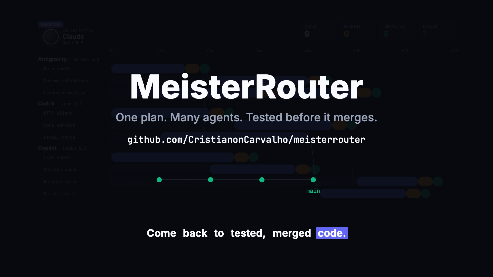
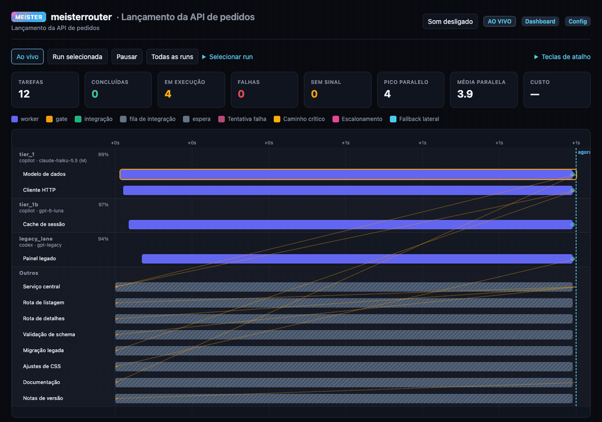
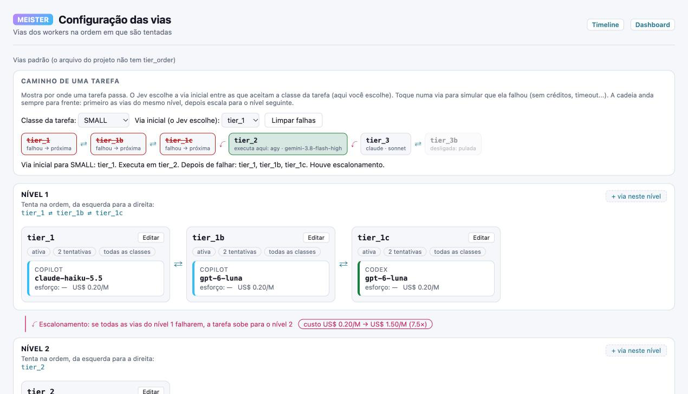
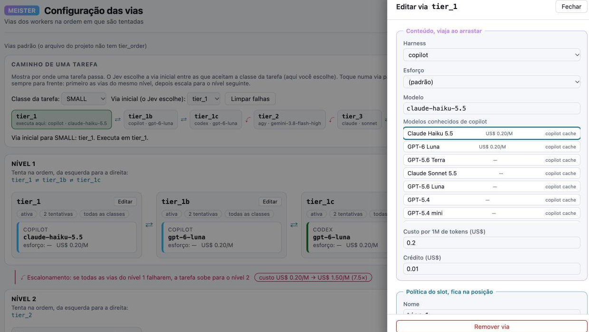
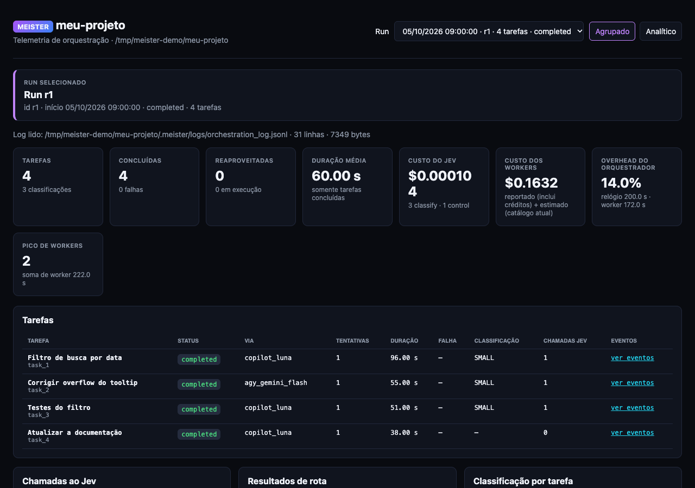

# 🔮 MeisterRouter

[](docs/video/meister-overview.mp4)

<sub>▶ Clique para assistir à visão geral de 56 segundos (em inglês, com legendas). Os agentes do vídeo são exemplos: você escolhe os seus e a ordem deles.</sub>

🌐 [English](README.md) · **Português (Brasil)**

### Entregue um plano aos seus agentes de IA. Quando voltar, o código já estará testado e integrado.

O **MeisterRouter** (`meister`) divide um plano em tarefas e as executa **em paralelo** nas CLIs de IA que você já paga: **GitHub Copilot, Claude, Codex, Gemini e Kiro**. Cada tarefa trabalha no seu próprio worktree do git, e nada chega à `main` até que um **gate determinístico** (os seus testes e linters, não a opinião do agente) diga que passou. Tarefa rejeitada é reparada automaticamente. Quando uma assinatura fica sem cota, a seguinte assume.

Você guarda o seu modelo premium para o que ele faz de melhor: pensar. As vias mais baratas digitam, e um gate que você controla decide o que entra.



<sub>Esta é a linha do tempo ao vivo, que abre no navegador quando uma run começa (`/timeline`). Ela toca uma run **de demonstração** (dados sintéticos) gerada pelo próprio MeisterRouter; nenhum projeto real aparece nela.</sub>

## 🧨 O que você deixa de fazer

| Antes | Com o MeisterRouter |
|---|---|
| Gastar a cota do seu melhor modelo digitando | O orquestrador só planeja e verifica. As tarefas rodam na via mais barata que serve (os preços de lista vão de US$ 0,20 a US$ 8,00 por 1M de tokens), e as vias caras só entram no escalonamento. |
| Ler cada diff porque "pronto" quer dizer "o agente disse" | Uma tarefa está pronta quando `pytest`, `mvn test`, `npm test`, `cargo test` ou o que você configurou passa, num worktree isolado, antes da integração. |
| Ver agentes sobrescrevendo uns aos outros | As tarefas declaram os arquivos que podem alterar. As que não compartilham arquivos rodam em paralelo; alteração fora do escopo é barrada. |
| Recomeçar do zero quando a tarefa 7 falha | As runs retomam por tarefa: o que terminou é reaproveitado, mesmo depois de você editar o plano. |
| Esperar a cota voltar | Uma cadeia de fallback passa a tarefa para a via seguinte, com tratamento de rate limit e circuit breaker. |
| Não saber onde foram o tempo e o dinheiro | Timeline e dashboard ao vivo, com custo por tarefa, fases e escalonamentos. |

## 🚀 Comece agora

Dois comandos, e depois é só conversar.

```bash
# 1. Instale (macOS ou Linux; Windows: veja o guia)
curl -fsSL https://raw.githubusercontent.com/CristianonCarvalho/meisterrouter/main/bin/install.sh | bash

# 2. No seu projeto, uma vez
meister setup --project
```

**3. Abra a sua LLM orquestradora** (por exemplo o Claude Code) e diga o que você quer:

> *"quero um filtro por data na tela de pedidos"*

**Essa frase é a interface toda.** A sua LLM conversa com você, escreve o plano e o executa com o Meister: você não digita `meister plan` nem `meister orchestrate`. Quando a run começa, **a timeline ao vivo abre sozinha no seu navegador**: você acompanha cada tarefa em tempo real, com o harness e o modelo que a executam, as fases e o custo (no terminal: `meister timeline`). Commit, push e merge continuam esperando o seu OK.

Você precisa do git e de pelo menos uma CLI de IA que já paga (veja [Pré-requisitos](#-pré-requisitos)). Opções do instalador, como atualizar, a chave do Jev, os comandos à mão e a recuperação de falhas estão no [guia de primeiros passos](docs/pt-BR/PRIMEIROS_PASSOS.md).

## 🧭 Como funciona

1. **Você (ou a sua LLM orquestradora) escreve um plano**: tarefas pequenas, cada uma com os arquivos que pode alterar e as tarefas de que depende ([formato do plano](docs/pt-BR/FORMATO_DO_PLANO.md)).
2. **O Meister roteia cada tarefa** para uma via (uma CLI de assinatura com um modelo), em paralelo sempre que os arquivos não se sobrepõem.
3. **Cada tarefa roda no seu próprio worktree do git.** O worker edita ali, nunca no seu checkout.
4. **O gate determinístico roda** (testes, lint, tipos). Rejeitada? Uma tentativa automática de reparo. Sem cota? Próxima via.
5. **O trabalho aprovado é integrado**, e a `main` só avança, por fast-forward, no final.

O único componente não determinístico é o **Jev** (via OpenRouter), um roteador opcional que escolhe a via inicial e julga o resultado. Sem ele, use `router: {mode: first}` e o roteamento fica totalmente determinístico, sem rede.

📐 Mais nos [diagramas](docs/pt-BR/DIAGRAMAS.md): componentes, sequência, roteamento, falhas, gates e estados.

## 🧪 Provas, não promessas

- **É desenvolvido com ele mesmo.** As alterações deste repositório passam pelo `meister orchestrate` e pelo mesmo gate (mais de 2.300 testes, ruff e mypy em Linux e Windows na CI).
- **Stacks reais, gates reais.** O gate detecta `pytest`, `vitest`, `npm test`, `cargo test` e **Maven** (`pom.xml`, inclusive Java 8), e você pode definir os seus próprios comandos. Veja [Java 8, Maven e GitLab](docs/pt-BR/JAVA_MAVEN.md).
- **Funciona com uma assinatura só.** Você não precisa das cinco CLIs; por exemplo, [só o Kiro](docs/pt-BR/KIRO.md) é um comando: `meister config init --kiro`.
- **Limites honestos.** O Windows é nativo, mas ainda em validação, o Kiro não foi verificado no Windows, e um subagente é a ferramenta melhor para uma alteração de uma linha (veja abaixo).

**Quando o subagente é a ferramenta melhor:** uma alteração pequena, uma exploração ou uma depuração interativa. O MeisterRouter acrescenta processo (um plano, tarefas com escopo, um gate completo em cada uma), então compensa em planos com várias tarefas, não em mudanças avulsas.

## ✅ Pré-requisitos

| | O quê | Para quê |
|---|---|---|
| **Obrigatório** | macOS, Linux ou Windows 10/11 (nativo, **em validação**; exige o [Git for Windows](https://git-scm.com/download/win)) | Onde o MeisterRouter roda. Veja [Windows](docs/pt-BR/INSTALACAO_E_COMANDOS_AVANCADOS.md#windows). |
| **Obrigatório** | Ao menos uma CLI de IA com assinatura: `copilot`, `claude`, `codex`, `agy` (Antigravity/Gemini) ou `kiro-cli` | São os workers. O `meister setup` mostra quais ele encontrou. |
| **Recomendado** | Uma LLM orquestradora com planejamento, por exemplo o **Claude Code** | Ela conversa com você, escreve o plano no [formato do plano](docs/pt-BR/FORMATO_DO_PLANO.md) (o `meister plan guide` e o `meister plan new` dão a ela as regras e um esqueleto) e aciona o Meister. Se você usa a skill [Superpowers](https://github.com/obra/superpowers), os planos dela já seguem esse formato. |
| **Opcional** | Uma chave da API do OpenRouter | Só o **Jev** a usa (escolhe a via de cada tarefa). Sem ela, use `router: {mode: first}`. |
| **Opcional** | [Herdr](#-herdr-opcional-acompanhe-os-workers-ao-vivo) ou tmux | Para ver cada worker ao vivo, na sua própria aba. |

## 🎯 Escolha os modelos e a ordem deles

Cada **via** é uma assinatura (um harness, como Copilot, Codex, Claude ou Gemini) rodando um modelo. A **ordem** das vias é a cadeia de fallback, sempre para frente: se uma via falha ou fica sem crédito, o Meister passa para a seguinte. Você define tudo numa página web, sem arquivo para editar:

```bash
meister config web       # abre a página de configuração do projeto atual
```

(`--no-open` só imprime o endereço, para uma máquina sem tela. `meister models` lista as vias ativas no terminal.)



### Níveis, vias e escalonamento

- As vias são agrupadas em **níveis** (o número no fim do nome: `tier_1`, `tier_1b` e `tier_1c` são o nível 1). Vias do mesmo nível são alternativas: o Meister as tenta da esquerda para a direita (⇄ fallback lateral).
- Quando **todas as vias de um nível falham**, a tarefa **escala** para o nível seguinte (⤹). A faixa entre os níveis mostra quanto o preço por milhão de tokens sobe, então você vê o que um escalonamento custa (por exemplo, de US$ 0,20 para US$ 1,50).
- Cada caixa é um **slot**: o nome, se está ativo, quantas tentativas tem e quais classes de tarefa aceita, com o conteúdo da via dentro (harness, modelo, esforço e custo).
- O **caminho de uma tarefa**, no alto, responde "onde a minha tarefa rodaria?". Escolha a classe da tarefa e a via inicial e clique numa via para fingir que ela falhou (sem crédito, timeout...). Uma frase diz onde a tarefa acaba rodando e se houve escalonamento. Nada é executado; a imagem acima mostra o Copilot e o Codex falhando e a tarefa caindo no Gemini.



### Editando uma via

Clique em **Editar** num slot. A gaveta tem dois grupos:

- **Conteúdo** (viaja quando você arrasta o cartão): harness, esforço (a lista acompanha o harness), modelo, custo por milhão de tokens e crédito.
- **Política do slot** (fica no lugar): nome, ligada ou desligada, tentativas, limite em paralelo, tempo ocioso e duração máxima, as classes de tarefa que o Jev pode enviar à via e para que ela é mais indicada.

O **modelo** é escolhido entre os modelos conhecidos do harness da via, cada um com o nome exato que aquele harness espera (eles escrevem o mesmo modelo de jeitos diferentes: `claude-haiku-5.5` no Copilot, `haiku` no Claude) e o custo, quando conhecido. Você também pode digitar qualquer nome; se ele não estiver na lista, a página avisa sem impedir. De onde vêm as listas:

| Harness | Lista de modelos |
|---|---|
| Gemini (`agy`) | lida ao vivo da própria ferramenta |
| Codex | a lista que o próprio Codex guarda |
| Claude | os aliases (`haiku`, `sonnet`, `opus`) e os nomes completos |
| Copilot | lida uma vez do seletor `/model` dele com `meister config refresh-models copilot` (o Copilot não tem comando de listagem; o seletor é aberto num terminal simulado e **nenhum prompt é enviado**, então não gasta crédito) |

### Reordenar, criar e remover

- **Trocar o conteúdo entre slots:** arraste um cartão sobre outro slot (no celular, toque num cartão e depois no outro). Os nomes e as políticas ficam onde estão, então a estrutura do fallback se mantém enquanto você muda quem roda onde.
- **+ via neste nível** acrescenta uma alternativa; **+ novo nível** acrescenta uma etapa de escalonamento no fim da cadeia; **Remover via** apaga uma (confirme com um segundo toque).
- O painel **Alterações a gravar** lista exatamente o que será escrito. **Salvar** aplica, **Reverter** descarta e **Restaurar padrão** volta às vias empacotadas.

### Qual projeto estou configurando?

A configuração continua **por projeto**, e a página sempre diz qual está editando: a barra **Projeto**, no topo, mostra uma caixa de seleção e o caminho completo do projeto (e o arquivo de origem logo abaixo). Escolha outro projeto na caixa e a página carrega as vias dele; nada é gravado no projeto que você deixou.

- **Lista automática:** um projeto entra na lista quando você roda `meister config web`, sobe um dashboard ou roda `meister orchestrate` dentro dele. A lista fica em `~/.meister/projects.json`.
- **Descobrir projetos:** digite uma pasta (por exemplo, a que guarda todos os seus repositórios) e o Meister procura nela, até 3 níveis, pastas com `.meister/` ou `meister.config.yaml`. Você marca as que quer e registra.
- **Adicionar projeto:** registra uma pasta pelo caminho absoluto. Ela precisa ter `.meister/`, `meister.config.yaml` ou `.git`; a pasta pessoal e a raiz do sistema são recusadas.
- Cada projeto é verificado por conta própria: uma run ativa em um projeto bloqueia só aquele projeto, e o projeto com run aparece assim na caixa de seleção.

### Salvar em todos os projetos

**Salvar em todos os projetos** (ao lado de **Salvar**) grava a lista de vias em edição no projeto atual e em todos os outros da lista. Uma confirmação mostra antes os nomes dos projetos. Os que têm run em andamento são pulados, o projeto cuja pasta sumiu também, e um que falhe (por exemplo, YAML inválido) não impede os outros. Em seguida, uma lista de resultado mostra o que aconteceu em cada projeto. Todo arquivo de configuração que já existia mantém uma cópia `.bak`, e o projeto sem `meister.config.yaml` ganha um com as vias. As vias casam pelo nome em cada destino, então os campos que a página não edita são mantidos.

### Editar pelo celular (Tailscale)

Por padrão a página é **somente leitura** quando chega pelo Tailscale. Para permitir que o seu login grave pelo celular, liste-o no `meister.config.yaml` do projeto que o dashboard serve:

```yaml
dashboard:
  remote_edit_logins: ["voce@exemplo.com"]
```

O Tailscale informa ao dashboard quem está chamando (a comparação ignora maiúsculas e minúsculas). Qualquer outra pessoa da sua tailnet, e qualquer pedido sem login, continua só lendo. As demais proteções valem: run em andamento, arquivo alterado, vias válidas.

### Bom saber

- Salvar é bloqueado enquanto há uma run ativa (a run já carregou as vias), e a página fica só para leitura quando aberta remotamente, por exemplo pelo Tailscale, a menos que o seu login do Tailscale esteja em `dashboard.remote_edit_logins` no `meister.config.yaml` (aí você edita pelo celular; veja abaixo).
- Salvar guarda uma cópia da configuração anterior e nunca deixa um arquivo pela metade. Os nomes são conferidos antes de gravar (únicos, terminando no número do nível) e pelo menos uma via precisa ficar ligada.
- Uma lista salva passa a ser do projeto e substitui a padrão, então deixa de acompanhar as mudanças futuras das vias empacotadas; **Restaurar padrão** desfaz isso.

O esforço de raciocínio, na lista **Esforço** da gaveta, depende do harness:

| Harness | Valores de esforço (opcional; deixe em "padrão" para manter o do harness) |
|---|---|
| `copilot` | none, minimal, low, medium, high, xhigh, max |
| `claude`, `agy` | low, medium, high, xhigh, max |
| `codex` | minimal, low, medium, high, xhigh |
| `kiro-cli` | low, medium, high, xhigh, max (o modelo precisa suportar) |

Mais sobre esta página e as demais configurações: [a tela /config](docs/pt-BR/INSTALACAO_E_COMANDOS_AVANCADOS.md#tela-config-vias) e [configuração avançada](docs/pt-BR/INSTALACAO_E_COMANDOS_AVANCADOS.md#configuração-avançada).

## 🔍 Por baixo dos panos

Estas gravações mostram o que a sua LLM orquestradora roda por você. **Você não digita nada disso.** Os workers são simulados, então as demonstrações são rápidas e não gastam cota; a orquestração, os worktrees, o gate, o fallback e a integração são os de verdade.

### Paralelo por padrão, integrado só no fim

As tarefas 1 e 2 não compartilham arquivos, então rodam juntas. A tarefa 3 depende das duas e espera. A `main` só avança depois que tudo passou.


### Quem decide é o gate, não o agente

A primeira tentativa do worker tem um bug. O gate o pega antes de qualquer integração, a tarefa é reparada automaticamente e só a versão que passa chega à `main`.


### A cota acabou? A próxima via assume


### O dashboard

O `meister dashboard` (em `http://localhost:5050`) acrescenta métricas por run, custo, overhead e a tabela de tarefas:



<sub>A imagem do dashboard também usa uma run de demonstração (dados sintéticos).</sub>

A página da timeline (`/timeline`) tem uma caixa **Projeto** no topo: escolha qualquer projeto da lista registrada (a mesma da `/config`) para ver as runs e a timeline dele, só leitura. A escolha fica na URL, então dá para guardar o link.

## 💻 Herdr (opcional): acompanhe os workers ao vivo

O [Herdr](https://herdr.dev) é um gerenciador de espaços de trabalho de terminal. O MeisterRouter não precisa dele, mas pode rodar como plugin do Herdr: cada worker abre então numa **aba visível**, e atalhos abrem o dashboard e a timeline como popups.

| Atalho | Abre |
|---|---|
| `prefix+m` | Inicia a orquestração no workspace |
| `prefix+shift+m` | Popup do dashboard |
| `prefix+t` | Popup da timeline (Gantt) |

Para usar, instale o Herdr (`curl -fsSL https://herdr.dev/install.sh | sh`) e rode o `meister setup`: ele liga o plugin e registra os atalhos num bloco gerenciado do `config.toml` do Herdr, com backup. Sem o Herdr, o `meister setup` avisa e segue.

`runtime.host` no `meister.config.yaml` escolhe onde cada worker roda:

| Valor | Onde o worker roda |
|---|---|
| `auto` (padrão) | No Herdr quando ele está acessível, senão num processo em segundo plano (o `auto` nunca escolhe o tmux) |
| `process` | Um processo simples em segundo plano (sem abas, popups nem atalhos). É o único host no Windows. |
| `herdr` | Uma aba visível do Herdr (exige o Herdr) |
| `tmux` | Uma janela do tmux (exige o tmux 3.0 ou mais novo) |

## 📚 Mais documentação

- [Primeiros passos](docs/pt-BR/PRIMEIROS_PASSOS.md): opções de instalação, a chave do Jev, uma sessão passo a passo e os comandos à mão.
- [Formato do plano](docs/pt-BR/FORMATO_DO_PLANO.md): como escrever ou revisar um plano (`plan guide`, `plan new`; o Superpowers é opcional), dependências e paralelismo.
- [Instalação alternativa e comandos avançados](docs/pt-BR/INSTALACAO_E_COMANDOS_AVANCADOS.md): outras formas de instalar, atalhos à mão, `plan`/`orchestrate` à mão, `init`/guard, `classify`, `control`, `worker`, `clean`, `--resume`, opções do dashboard e da timeline, configuração avançada, testes e estrutura do projeto.
- [Diagramas](docs/pt-BR/DIAGRAMAS.md): componentes, sequência e fluxos.
- [Manual de execução](docs/pt-BR/MANUAL_DE_EXECUCAO.md): o que fazer em cada situação e como se recuperar de falhas.
- [Java 8, Maven e GitLab](docs/pt-BR/JAVA_MAVEN.md): detecção do Maven no gate (`pom.xml`), `gate.env` com `JAVA_HOME`, uso do mesmo Maven do Eclipse e merge requests no GitLab.
- [Testar lotes Java sem homologação](docs/pt-BR/TESTES_JAVA_SEM_HOMOLOGACAO.md): fixtures, site falso (WireMock), golden master e dry-run, com um exemplo funcional em Java 8.
- [Kiro CLI](docs/pt-BR/KIRO.md): o Kiro CLI como harness (`kiro-cli`), configuração só com o Kiro, modelos e créditos, esforço e limitações.
- [Modelos e custos](docs/pt-BR/MODELOS_E_CUSTOS.md) e o [CHANGELOG](CHANGELOG.pt-BR.md). Versão instalada: `meister --version`.

> Idioma: as mensagens e os relatórios da CLI saem em inglês por padrão. Defina `language: pt-BR` no `meister.config.yaml` (ou `MEISTER_LANG=pt-BR`) para trocá-los para português. A documentação está em inglês (aqui e em `docs/`) e em português (`README.pt-BR.md`, `docs/pt-BR/`).

## Licença

[MIT](LICENSE)
